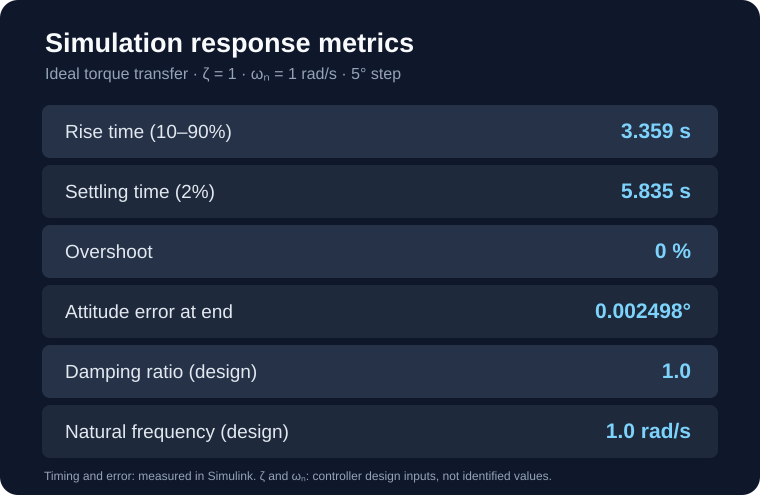

# Reaction Wheel Development

**리액션휠 기반 위성 자세제어 — 모델 기반 PD 제어기 설계 및 응답 검증**

이 저장소는 3축 리액션휠 기반 위성 자세제어기를 수학적 모델로 설계하고, MATLAB/Simulink에서 예측한 자세 응답을 검증하는 연구 기록이야. 현재는 **이상적 토크 전달 모델(ideal actuator baseline)**에 대한 첫 검증 결과를 정리했어.

> **현재 검증 범위 (2026-11-17):** 제어기 명령 토크가 지연·포화·마찰 손실 없이 위성 동역학에 그대로 적용된다고 가정. **마찰·토크 오차, 실제 휠 모터 제어, STM32 펌웨어/실물 시험 결과는 아직 포함되지 않았어.**

## 1. 연구 목표 및 모델 구조

- 위성의 회전 동역학 및 쿼터니언 운동학을 Simulink에서 모델링
- 목표 자세와 현재 자세의 **오차 쿼터니언 및 각속도 오차**를 사용해 PD 토크 명령 생성
- 감쇠비 `ζ`와 고유진동수 `ω_n`으로 PD 이득을 **해석적으로 설계**
- 시간응답을 이론적인 2차 시스템과 비교하여 상승시간, 정착시간, 오버슈트 및 자세 오차 검증

```text
목표 자세 q_cmd ──┐
                   ▼
               오차 계산 ──> PD 자세제어기 ── τ_cmd ──> 위성 동역학 ──> ω, q
                   ▲                                          │
                   └────────────── q, ω 피드백 ────────────────┘
```

현재 단계에서는 `τ_actual = τ_cmd`를 가정해 위성 동역학에 토크를 직접 넣었어. 리액션휠 토크 분배·모터 구동·마찰 모델은 추후 별도 검증할 예정이야.

### 자세 오차 및 PD 제어법칙

본 프로젝트의 쿼터니언 순서: **벡터 성분 먼저, 스칼라 성분 마지막** `q = [q_x, q_y, q_z, q_4]^T`.

오차 쿼터니언은 원본 제어기에서 사용한 정의에 맞춰

$$
q_e = q \otimes q_{cmd}^{-1}
$$

로 계산하고, 제어에는 오차 쿼터니언의 **벡터 성분** `q_{e,v}\in\mathbb{R}^3`를 사용해.

$$
\tau_{cmd}
=-K_P q_{e,v}-K_D(\omega-\omega_{cmd})
+J_{eff}\alpha_{cmd},\qquad J_{eff}=J_{sc}-J_a.
$$

목표 자세 근처에서 `q_{e,v}\approx e/2`로 선형화하고, 단일축의 특성방정식

$$
s^2+\frac{K_D}{J_{eff}}s+\frac{K_P}{2J_{eff}}=0
$$

을 표준 2차 시스템 `s^2 + 2ζω_n s + ω_n^2 = 0`과 비교하면,

$$
\boxed{K_P=2\omega_n^2 J_{eff}},\qquad
\boxed{K_D=2\zeta\omega_n J_{eff}}
$$

를 얻을 수 있어. 이 설계식은 **소각도 선형화 및 단일축/축간 결합 무시 조건**에서 적용해.

## 2. 검증 조건 — X축 5° 자세 기동

| 항목 | 값 |
|:--|:--|
| 시험 형태 | X축 목표 자세 5° 계단입력, 폐루프 시뮬레이션 |
| 목표 쿼터니언 `q_cmd` | `[sin(pi/72); 0; 0; cos(pi/72)]` |
| 초기 자세 `q(0)` | `[0; 0; 0; 1]` |
| 초기 각속도 `ω(0)` | `[0; 0; 0]` rad/s |
| 목표 각속도·각가속도 | `[0; 0; 0]` |
| 리액션휠 초기 모멘텀 입력 | `hRW = [0; 0; 0]` (단순화) |
| 설계 감쇠비 `ζ` | **1.0** (임계감쇠) |
| 설계 고유진동수 `ω_n` | **1.0 rad/s** |
| X축 유효 관성모멘트 `J_eff,x` | **0.199 kg·m²** |
| X축 PD 게인 | `K_P,x = 0.398`, `K_D,x = 0.398` |
| 시뮬레이션 시간 | **10초** |
| 적분 설정 | Variable-step / ode45, RelTol `1e-8`, Max step `0.001 s` |
| 구동기 가정 | **이상적 토크 전달** (마찰/지연/포화 없음) |

현재 자세 `q`는 위성 모델이 계산한 각속도 `ω`로부터 쿼터니언 운동학 `q̇ = 1/2 Ω(ω)q`를 적분해 계산했어.

## 3. 시뮬레이션 결과

### 토크 · 각속도 · 회전각 응답


*그림: 동일한 설정(`ζ=1`, `ω_n=1`, `J_eff,x=0.199`)의 **선형화된 2차 모델 해석식으로 재구성한 참고 그래프**. 아래 표의 성능값은 실제 Simulink 측정 화면에서 읽은 값이야.*

### 측정 출력 특성



| 지표 | Simulink 측정값 | 비교 기준 |
|:--|--:|:--|
| 상승시간 `T_r` (10→90%) | **3.359 s** | 임계감쇠 이론 응답 약 3.358 s |
| 정착시간 `T_s` (±2%) | **5.835 s** | 임계감쇠 이론 응답 약 5.834 s |
| 최대 오버슈트 `%OS` | **0 %** | 임계감쇠 이론 응답 0% |
| 10초 시점 자세 오차 | **0.002498°** | 0°에 가까워지는 중 |
| 설계 감쇠비 `ζ` | **1.0** | `K_P, K_D`로 지정한 설계값 |
| 설계 고유진동수 `ω_n` | **1.0 rad/s** | `K_P, K_D`로 지정한 설계값 |

> 계측용 MATLAB Function에서 `ζ`와 `ω_n`이 **-1**로 나타난 것은 **측정 실패 표시**야. 기존 로직은 양의 오버슈트로 감쇠비를 역산하므로 `%OS=0`이면 사용할 수 없어. **-1은 실제 물리값이 아니고**, 위 표의 `ζ=1, ω_n=1`은 *제어기 설계값*이야.

### 이론 응답과 비교

초기 회전각 0°, 목표 5°인 임계감쇠 2차 시스템에서 `ζ=1, ω_n=1 rad/s`이면 선형화된 자세 응답은

$$
\theta(t)=5\left[1-(1+t)e^{-t}\right]\quad[\mathrm{deg}]
$$

야. 따라서

$$
\theta(10)\approx4.997503^\circ,\qquad
e(10)\approx0.002497^\circ.
$$

위성의 각속도는 약 1초에서 최대에 도달한 뒤 0으로 감소하고, 제어 토크는 초기 양(+)의 값에서 감소해 감속 구간에서 음(-)의 값으로 변한 후 0에 수렴해. 측정된 `T_r`, `T_s`, `%OS`, 10초 자세 오차는 **설계한 이상적 2차 모델의 이론값과 잘 일치**했어.

**이번 시험의 결론:** 외란과 구동기 손실이 없는 조건에서, 설계한 PD 게인이 의도한 **임계감쇠 자세 응답**을 구현함을 Simulink 폐루프 시험으로 확인했어. 이것은 실제 하드웨어 성능의 입증이 아니라 **이상적 모델 기준선(baseline)** 검증이야.

## 4. 후속 검증 계획 (아직 결과 없음)

- **리액션휠 마찰 영향:** 점성마찰과 쿨롱마찰을 포함한 모델을 별도 구성하고 기준선과 비교
- **토크 명령 ↔ 실제 토크 차이:** 휠 구동 응답, 지연, 제한조건을 적용한 뒤 자세 응답 변화 검토
- **STM32 구현 및 실물 검증:** 제어기 펌웨어 구현 후 Simulink 예측과 계측값 비교

이 항목들은 **계획**이며 이 README에 성능 검증 결과로 포함하지 않았어.

---

### 사용 도구

- MATLAB / Simulink
- Simulink Simulation Data Inspector (신호 기록 및 시간응답 비교)
- Dashboard Display (상태 및 성능지표 표시)
