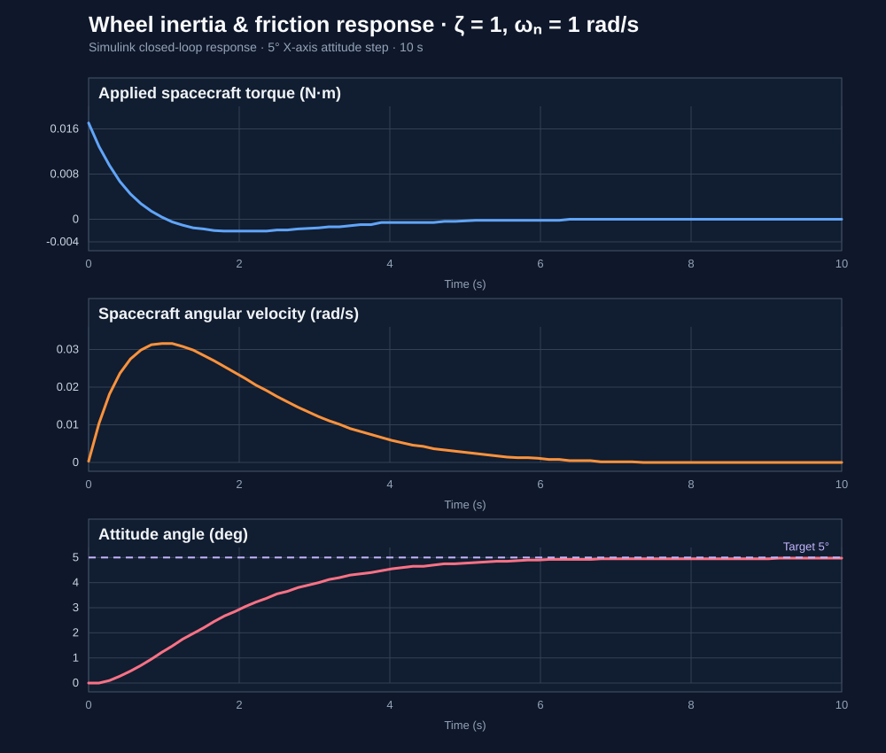
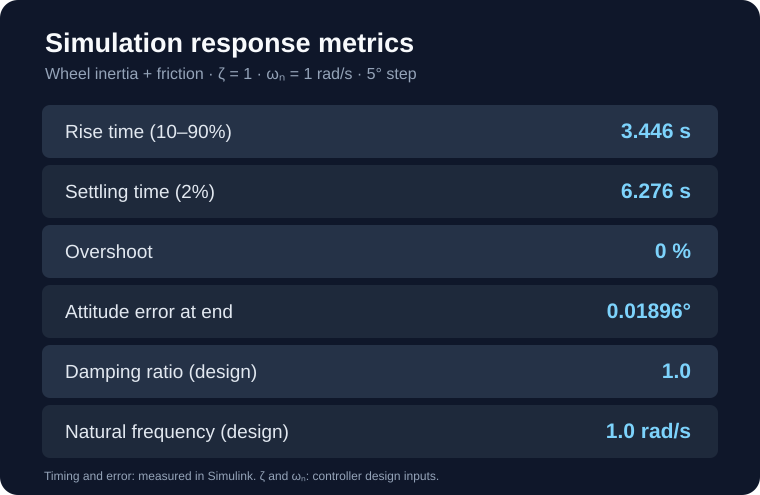

# 리액션휠 기반 위성 자세제어

<p align="center">
  
  
  
</p>

**모델 기반 자세제어기 설계 및 MATLAB/Simulink 응답 검증**

3축 리액션휠 위성의 회전 동역학과 쿼터니언 자세 표현을 정리하고, 원하는 응답 특성으로부터 PD 게인을 설계하여 시뮬레이션으로 검증하는 프로젝트이다. 현재 **X축 5° 자세 기동**을 기준으로 이상적 토크 전달과 휠 관성·마찰 모델의 응답을 비교하였다.

> **진행 범위:** 동역학·제어기 설계 및 X축 시뮬레이션 검증 완료 / Spin-to-Spin 자세명령 생성은 이론 정리 단계 / STM32 및 실물 시험 미수행

## 1. 시스템 구성

```text
목표 자세 q_cmd, 목표 각속도 ω_cmd, 목표 각가속도 α_cmd
                       │
                       ▼
               자세·각속도 오차 계산
                       │
                       ▼
                  PD 자세제어기
                       │ τ_cmd (위성 본체 토크 명령)
                       ▼
                 Wheel_Control_Model ── τ_actual ──> 위성 동역학 ──> q, ω
                       ▲                                   │
                       └──── 휠 속도 및 위성 각속도 ───────────┘
```

이상적 구동기 시험에서는 `Wheel_Control_Model`을 생략하고 $\tau_{actual}=\tau_{cmd}$로 설정한다. 휠 제어 모델을 추가한 시험에서는 관성과 마찰을 고려한 실제 적용 토크를 위성 모델에 전달한다.

## 2. 위성 동역학과 자세 표현

### 리액션휠을 포함한 회전 동역학

위성 본체와 휠의 회전 운동을 고려한 비선형 동역학은 다음과 같다.

$$
J_{sc}\dot{\boldsymbol\omega}
=(J_{sc}\boldsymbol\omega+J_a\boldsymbol\nu)\times\boldsymbol\omega
-J_a\boldsymbol\mu+\boldsymbol\tau_{dist}
$$

리액션휠의 모터 토크를 $T_m=J_a(\dot{\boldsymbol\omega}+\boldsymbol\mu)$로 놓으면,

$$
\boxed{
(J_{sc}-J_a)\dot{\boldsymbol\omega}
=(J_{sc}\boldsymbol\omega+J_a\boldsymbol\nu)\times\boldsymbol\omega
-\boldsymbol T_m+\boldsymbol\tau_{dist}
}
$$

| 기호 | 의미 |
|:--|:--|
| $J_{sc}$, $J_a$ | 위성 전체 및 리액션휠의 관성행렬 |
| $\boldsymbol\omega$ | 위성 본체의 각속도 |
| $\boldsymbol\nu$, $\boldsymbol\mu$ | 위성 본체에 대한 휠의 상대 각속도 및 상대 각가속도 |
| $\boldsymbol T_m$, $\boldsymbol\tau_{dist}$ | 휠에 작용하는 모터 토크 및 외란 토크 |

$(J_{sc}\boldsymbol\omega+J_a\boldsymbol\nu)\times\boldsymbol\omega$는 각운동량에 의한 **축간 결합 항**이다. 단일축 소각도 제어기 설계에서는 이를 무시하여 선형화하지만, 비선형 위성 모델에서는 고려해야 한다.

### 쿼터니언 자세와 오차

쿼터니언은 **벡터 성분 우선, 스칼라 성분 마지막** 순서인 $q=[q_x,q_y,q_z,q_4]^T$를 사용한다.

$$
q(\theta,\hat{\boldsymbol e})=
\begin{bmatrix}
\hat{\boldsymbol e}\sin(\theta/2)\\
\cos(\theta/2)
\end{bmatrix},
\qquad
\dot q=\frac12\Omega(\boldsymbol\omega)q
$$

목표 자세에 대한 오차 쿼터니언은 다음과 같이 정의한다.

$$
q_e=q\otimes q_{cmd}^{-1}
$$

PD 제어에는 $q_e$의 **벡터 성분** $q_{e,v}\in\mathbb R^3$를 사용한다. 예를 들어 현재 Z축 자세가 0°, 목표가 +1°이면,

$$
q_{e,v}=
\begin{bmatrix}0\\0\\-\sin(0.5^\circ)\end{bmatrix}
\approx
\begin{bmatrix}0\\0\\-0.008727\end{bmatrix}
$$

가 된다. 따라서 비례 제어 토크 $-K_Pq_{e,v}$는 목표 방향인 **+Z축**으로 생성된다.

## 3. 모델 기반 PD 제어기 설계

### 토크 명령

$$
\boxed{
\boldsymbol\tau_{cmd}
=-K_Pq_{e,v}
-K_D(\boldsymbol\omega-\boldsymbol\omega_{cmd})
+(J_{sc}-J_a)\boldsymbol\alpha_{cmd}
}
$$

여기서 $\boldsymbol\tau_{cmd}=-\boldsymbol T_m$이며, 이는 **위성 본체에 적용하려는 토크 명령**이다. 휠 모터 토크는 반대 부호를 갖는다.

### 특성방정식으로부터 게인 도출

유효 관성행렬을 $J_{eff}=J_{sc}-J_a$로 정의한다. 목표 자세 부근의 소각도 조건에서

$$
q_{e,v}\approx\frac{\boldsymbol e}{2},\qquad
\dot{\boldsymbol e}=\boldsymbol\omega-\boldsymbol\omega_{cmd},\qquad
\ddot{\boldsymbol e}=\dot{\boldsymbol\omega}-\boldsymbol\alpha_{cmd}
$$

이고, 외란과 축간 결합을 무시하면 오차 동역학은

$$
J_{eff}\ddot{\boldsymbol e}
+K_D\dot{\boldsymbol e}
+\frac12K_P\boldsymbol e=0
$$

가 된다. $\boldsymbol e(t)=\boldsymbol v e^{st}\;(\boldsymbol v\ne0)$를 대입해 얻는 특성방정식은

$$
\det\left(J_{eff}s^2+K_Ds+\frac12K_P\right)=0
$$

이다. 이를 표준 2차 시스템 $s^2+2\zeta\omega_ns+\omega_n^2=0$에 대응시키면,

$$
\boxed{K_P=2\omega_n^2J_{eff}},
\qquad
\boxed{K_D=2\zeta\omega_nJ_{eff}}
$$

를 얻는다. 따라서 **경험적 게인 조정보다 먼저 목표 감쇠비와 고유진동수로 게인을 결정**할 수 있다. $J_{eff}$에 비대각 성분이 있으면 게인 행렬에도 축간 결합 성분이 반영된다.

## 4. 자세명령 생성: Spin-to-Spin (이론 정리)

고기동 자세명령은 목표 쿼터니언뿐 아니라 **목표 각속도 $\boldsymbol\omega_{cmd}$**와 **목표 각가속도 $\boldsymbol\alpha_{cmd}$**를 하나의 궤적으로 생성해야 한다. $\boldsymbol\alpha_{cmd}\ne0$인데 $\boldsymbol\omega_{cmd}=0$으로 고정하면 일관된 운동 명령이 아니다.

| 구간 | 동작 |
|:--|:--|
| Phase 1 — Spin-to-Rest | 초기 회전 감속 및 정지 |
| Phase 2 — Rest-to-Rest | 정지 상태에서 자세 변경 후 정지 |
| Phase 3 — Rest-to-Spin | 정지 상태에서 목표 각속도까지 가속 |
| Phase 4 — Stabilization | 목표 각속도 유지 |

Phase 3에서는 가속도 제한을 고려해 **Bang-Bang** 또는 **Bang-Off-Bang** 형태의 속도 프로파일을 선택한다. 가속도 상한을 초과하는 삼각형 프로파일 대신 가속·정속·감속 구간을 구성할 수 있다.

학습 노트의 Phase 4 예시에서는 종료 시각 $t_6=10\,s$, 안정화 시간 $3\,s$, 목표 각속도 크기 $2^\circ/s$, 회전축 $\hat{\boldsymbol e}=[0.6,\,0.8,\,0]^T$를 사용한다. $7\le t\le10\,s$에서

$$
\boldsymbol\omega_{cmd}=
\begin{bmatrix}1.2\\1.6\\0\end{bmatrix}\;[^\circ/s],
\qquad
\boldsymbol\alpha_{cmd}=\boldsymbol0,
\qquad
\theta_{cmd}(t)=2(t-10)^\circ
$$

이다. **위 예시는 자세명령 생성 원리의 정리이며, 아래 X축 계단입력 시험에 적용한 결과는 아니다.** 실제 Simulink 입력에는 각도·각속도를 각각 rad, rad/s 단위로 변환해야 한다.

## 5. 시뮬레이션 조건: X축 5° 자세 기동

| 항목 | 설정 |
|:--|:--|
| 목표 자세 $q_{cmd}$ | `[sin(pi/72); 0; 0; cos(pi/72)]` |
| 초기 자세 $q(0)$ | `[0; 0; 0; 1]` |
| 초기 각속도 / 목표 각속도·각가속도 | 모두 `[0; 0; 0]` |
| 설계 감쇠비 / 고유진동수 | **$\zeta=1$, $\omega_n=1\,rad/s$** |
| X축 유효 관성 $J_{eff,x}$ | **0.199 kg·m²** |
| X축 PD 게인 | **$K_{P,x}=0.398$, $K_{D,x}=0.398$** |
| 시뮬레이션 시간 | **10 s** |
| 적분 설정 | Variable-step `ode45`, RelTol `1e-8`, Max step `0.001 s` |
| 휠 각운동량 입력 | `hRW = [0; 0; 0]` (단일축 시험용 단순화) |

### 시험 A. 이상적 토크 전달


*그림: $\zeta=1$, $\omega_n=1$ 조건에서 선형화된 2차계의 해석적 기준 응답.*


임계감쇠 2차 시스템에서 예측한 자세각은

$$
\theta(t)=5\left[1-(1+t)e^{-t}\right]\;[^\circ]
$$

이다. 측정된 상승시간 **3.359 s**, 정착시간 **5.835 s**, 오버슈트 **0%**, 10초 자세오차 **0.002498°**는 이론값과 잘 일치하였다.

### 시험 B. 리액션휠 관성·마찰 추가

`Wheel_Control_Model`에 휠의 절대 각속도 상태와 마찰 토크를 추가하였다.

$$
\begin{aligned}
\boldsymbol\omega_{w,rel}
&=\boldsymbol\omega_{wheel,abs}-\boldsymbol\omega_{sc}\\
\boldsymbol T_f
&=\boldsymbol b\odot\boldsymbol\omega_{w,rel}
+\boldsymbol c\odot\operatorname{sgn}(\boldsymbol\omega_{w,rel})\\
\boldsymbol\tau_{actual}
&=\boldsymbol\tau_{cmd}+\boldsymbol T_f\\
\boldsymbol T_w&=-\boldsymbol\tau_{actual}\\
\dot{\boldsymbol\omega}_{wheel,abs}
&=J_a^{-1}\boldsymbol T_w
\end{aligned}
$$

- $\boldsymbol T_f$: 휠 속도에 의존하는 **마찰 토크 항** (휠에 작용하는 실제 마찰 토크는 $-\boldsymbol T_f$)
- $\boldsymbol T_w$: 휠에 작용하는 **순토크**
- $\boldsymbol\tau_{actual}$: 위성에 적용하는 **반작용 토크**

휠 관성은 $J_a=\operatorname{diag}(0.001,0.001,0.001)\;kg\cdot m^2$로 설정하였으며, MATLAB Function에서 `Awheel = Ja \ Tw`로 각가속도를 계산한다. 이 값을 적분해 휠 속도로 피드백한다. 0 부근에서의 마찰 불연속성은 필요 시 `tanh` 평활화로 근사할 수 있다.



*그림: X축 5° 자세 기동에서 휠 관성·마찰 모델을 추가한 후의 토크, 각속도 및 자세각 응답.*



### 시험 결과 비교

| 성능 지표 | 이상적 구동기 | 휠 관성·마찰 추가 | 변화 |
|:--|--:|--:|--:|
| 상승시간 $T_r$ (10–90%) | 3.359 s | **3.446 s** | +0.087 s |
| 정착시간 $T_s$ (±2%) | 5.835 s | **6.276 s** | +0.441 s |
| 최대 오버슈트 | 0% | **0%** | 0%p |
| 10초 시점 자세오차 | 0.002498° | **0.01896°** | +0.016462° |

마찰계수 $\boldsymbol b=\boldsymbol0$, $\boldsymbol c=\boldsymbol0$으로 설정하면 기존 이상적 모델과 **동일한 응답**을 확인하였다. 마찰을 추가한 경우 상승·정착시간과 자세오차가 증가하였으나 오버슈트는 발생하지 않았다.

> **해석 범위:** $\zeta$, $\omega_n$은 설계값 1.0이며, 계측 블록의 `-1` 표시는 역추정 불가를 뜻한다. 휠 마찰계수는 실측 식별값이 아니고, `hRW=0`으로 유지한 축별 근사 모델이므로 실제 3축 자이로 결합이나 하드웨어 성능까지 검증한 결과는 아니다.

## 6. 후속 개발

- **자세명령 생성 구현:** Spin-to-Spin에서 $q_{cmd}(t)$, $\omega_{cmd}(t)$, $\alpha_{cmd}(t)$를 일관되게 생성하고 추종 시험 수행
- **휠 모델 고도화:** 마찰계수 식별, 토크 제한·지연 및 3축 휠 각운동량 반영
- **STM32 검증:** 모델 기반 제어기 펌웨어 구현 후 Simulink 예측과 실측 응답 비교

**개발 도구:** MATLAB / Simulink, Simulation Data Inspector, Dashboard Display
