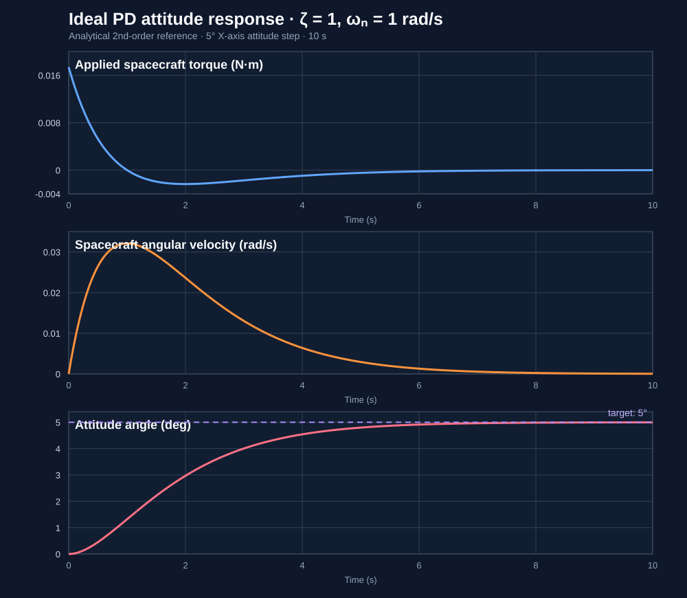

# 리액션휠 기반 위성 자세제어

<p align="center">
  
  
  
</p>

**모델 기반 PD 제어기 설계 및 위성 자세 응답 검증**

3축 리액션휠 기반 위성 자세제어를 대상으로 동역학 모델링, PD 제어기 설계, MATLAB/Simulink 응답 검증 과정을 정리한 저장소이다. 현재 기록은 **이상적 토크 전달 조건(ideal actuator baseline)**의 폐루프 자세제어 시험과, 여기에 **리액션휠 관성·점성마찰·쿨롱마찰 모델을 추가한 시험**의 결과를 비교한다.

> **현재 검증 범위 (2026-11-17):** (1) 마찰·지연·포화가 없는 이상적 토크 전달 조건, (2) 휠 관성 및 점성·쿨롱마찰을 포함한 시뮬레이션 조건. 실제 마찰계수의 식별, 모터 구동기 폐루프, STM32 펌웨어 및 실물 시험은 수행·검증되지 않았다.

## 전체 제어 흐름

- 위성의 회전 동역학 및 쿼터니언 운동학을 Simulink에서 모델링
- 목표 자세와 현재 자세의 **오차 쿼터니언 및 각속도 오차**를 사용해 PD 토크 명령 생성
- 감쇠비 `ζ`와 고유진동수 `ω_n`으로 PD 이득을 **해석적으로 설계**
- 시간응답을 이론적인 2차 시스템과 비교하여 상승시간, 정착시간, 오버슈트 및 자세 오차 검증

```text
목표 자세 q_cmd ──┐
                   ▼
               오차 계산 ──> PD 자세제어기 ── τ_cmd ──> 위성 동역학 ──> ω, q
                   ▲                                          │
                   └────────────── q, ω 피드백 ────────────────┘
```

첫 번째 시험에서는 `τ_actual = τ_cmd`인 이상적 토크 전달을 가정한다. 두 번째 시험에서는 `Wheel_Control_Model`을 중간에 연결하여 휠 관성 및 마찰 토크를 반영한다. 모터 전류·속도 폐루프와 하드웨어 검증은 후속 단계이다.

### 자세 오차 및 PD 제어법칙

쿼터니언은 **벡터 성분을 먼저 배치하고 스칼라 성분을 마지막에 배치하는 형식** `q = [q_x, q_y, q_z, q_4]^T`을 사용한다.

오차 쿼터니언은 기준으로 삼은 논문의 정의에 따라

$$
q_e = q \otimes q_{cmd}^{-1}
$$

로 계산한다. 실제 제어 토크 계산에는 오차 쿼터니언의 **벡터 성분** `q_{e,v}\in\mathbb{R}^3`를 사용한다.

$$
\tau_{cmd}
=-K_P q_{e,v}-K_D(\omega-\omega_{cmd})
+J_{eff}\alpha_{cmd},\qquad J_{eff}=J_{sc}-J_a.
$$

목표 자세 근처에서 `q_{e,v}\approx e/2`로 선형화하면 단일축의 특성방정식은 다음과 같다.

$$
s^2+\frac{K_D}{J_{eff}}s+\frac{K_P}{2J_{eff}}=0
$$

이 식을 표준 2차 시스템 `s^2 + 2ζω_n s + ω_n^2 = 0`과 비교하면,

$$
\boxed{K_P=2\omega_n^2 J_{eff}},\qquad
\boxed{K_D=2\zeta\omega_n J_{eff}}
$$

를 얻는다. 이 설계식은 **소각도 선형화 및 단일축 근사(축간 결합 무시)**를 전제로 한다.

## 시험 조건: X축 5° 자세 기동

| 항목 | 값 |
|:--|:--|
| 시험 형태 | X축 목표 자세 5° 계단입력, 폐루프 시뮬레이션 |
| 목표 쿼터니언 `q_cmd` | `[sin(pi/72); 0; 0; cos(pi/72)]` |
| 초기 자세 `q(0)` | `[0; 0; 0; 1]` |
| 초기 각속도 `ω(0)` | `[0; 0; 0]` rad/s |
| 목표 각속도·각가속도 | `[0; 0; 0]` |
| 리액션휠 초기 모멘텀 입력 | `hRW = [0; 0; 0]` (단순화) |
| 설계 감쇠비 `ζ` | **1.0** (임계감쇠) |
| 설계 고유진동수 `ω_n` | **1.0 rad/s** |
| X축 유효 관성모멘트 `J_eff,x` | **0.199 kg·m²** |
| X축 PD 게인 | `K_P,x = 0.398`, `K_D,x = 0.398` |
| 시뮬레이션 시간 | **10초** |
| 적분 설정 | Variable-step / ode45, RelTol `1e-8`, Max step `0.001 s` |
| 구동기 가정 | **기준선 시험:** 이상적 토크 전달 (마찰/지연/포화 없음) |

현재 자세 `q`는 위성 모델이 계산한 각속도 `ω`를 쿼터니언 운동학 `q̇ = 1/2 Ω(ω)q`에 대입하고, 이를 적분하여 얻는다.

## 이상적 토크 전달 조건의 시뮬레이션 결과

### 토크 · 각속도 · 회전각 응답



*그림: `ζ=1`, `ω_n=1`, `J_eff,x=0.199` 조건에서 **선형화된 2차 모델의 해석식으로 재구성한 참고 그래프**이다. 아래 성능 수치는 Simulink 측정 화면에서 확인한 값이다.*

### 측정 출력 특성


| 지표 | Simulink 측정값 | 비교 기준 |
|:--|--:|:--|
| 상승시간 `T_r` (10→90%) | **3.359 s** | 임계감쇠 이론 응답 약 3.358 s |
| 정착시간 `T_s` (±2%) | **5.835 s** | 임계감쇠 이론 응답 약 5.834 s |
| 최대 오버슈트 `%OS` | **0 %** | 임계감쇠 이론 응답 0% |
| 10초 시점 자세 오차 | **0.002498°** | 0°에 가까워지는 중 |
| 설계 감쇠비 `ζ` | **1.0** | `K_P, K_D`로 지정한 설계값 |
| 설계 고유진동수 `ω_n` | **1.0 rad/s** | `K_P, K_D`로 지정한 설계값 |

> 계측용 MATLAB Function에서 `ζ`, `ω_n`이 **-1**로 표시되는 것은 **해당 추정식을 적용할 수 없음을 나타내는 표시값**이다. 감쇠비 역산식은 양의 오버슈트를 전제로 하므로 `%OS=0`인 응답에는 적용하지 않는다. 표의 `ζ=1`, `ω_n=1`은 **응답에서 추정한 측정값이 아니라 제어기 설계값**이다.

### 이론 응답과 비교

초기 회전각 0°, 목표각 5°인 임계감쇠 2차 시스템에서 `ζ=1`, `ω_n=1 rad/s`일 때 선형화된 자세 응답은 다음과 같다.

$$
\theta(t)=5\left[1-(1+t)e^{-t}\right]\quad[\mathrm{deg}]
$$

따라서

$$
\theta(10)\approx4.997503^\circ,\qquad
e(10)\approx0.002497^\circ.
$$

위성 각속도는 약 1초에 최댓값에 도달한 후 0으로 감소한다. 제어 토크는 초기 양(+)의 값에서 감소하여 감속 구간에서 음(-)의 값으로 바뀐 후 0에 수렴한다. 측정된 `T_r`, `T_s`, `%OS` 및 10초 시점 자세 오차는 **설계 시 예측한 이상적 2차 시스템의 이론값과 잘 일치한다.**

**시험 결과:** 외란과 구동기 손실이 없는 조건에서 PD 제어기가 의도한 **임계감쇠 자세 응답**을 보이는 것을 Simulink 폐루프 시험으로 확인하였다. 이는 실제 하드웨어 성능을 입증한 결과가 아니라, 후속 비이상적 모델 및 실물 시험과 비교하기 위한 **이상적 모델 기준선(baseline)**이다.

## 휠 관성·마찰 모델 추가 시험 (2026-11-17)

기존 **이상적 토크 전달** 시험에 `Wheel_Control_Model`을 추가하여 리액션휠 관성 및 마찰 토크의 영향을 비교하였다. 테스트는 동일한 **X축 5° 목표 자세**, **10초 시뮬레이션**을 기준으로 하며, 게인을 다시 튜닝하지 않았다.

### 추가 모델 및 토크 정의

```text
목표 자세 → PD 자세제어기 → τ_cmd → Wheel_Control_Model → τ_actual → 위성 동역학 → q, ω_sc
                                           ↑       │
                              ω_wheel ← ∫ ω̇_wheel  │
                                           ↑       │
                              위성 각속도 ω_sc ─────┘
```

각 축의 리액션휠을 독립적인 단일축 회전체로 근사하여 다음 모델을 구현하였다.

$
\omega_{w,rel}=\omega_{wheel,abs}-\omega_{sc}
$

$
T_f=b\odot\omega_{w,rel}+c\odot\operatorname{sgn}(\omega_{w,rel})
$

$
\tau_{actual}=\tau_{cmd}+T_f,\qquad T_w=-\tau_{actual}
$

$
J_a\dot\omega_{wheel,abs}=T_w
\quad\Longrightarrow\quad
\dot\omega_{wheel,abs}=J_a^{-1}T_w.
$

- `τ_cmd`: **자세제어기에서 생성한 위성 본체 토크 명령** [N·m]
- `T_f`: 휠 각속도에 따라 부호가 정해지는 **마찰 토크 항** [N·m]; 실제 휠에 작용하는 마찰 토크는 `−T_f`
- `τ_actual`: 모델에서 위성 동역학에 적용하는 **본체 반작용 토크** [N·m]
- `T_w`: 휠에 작용하는 **순토크** [N·m]
- `ω_wheel,abs`, `ω_sc`: 각각 휠의 절대 각속도 및 위성 본체 각속도 [rad/s]

`Ja = diag([0.001, 0.001, 0.001])` kg·m²를 사용하였으며, MATLAB Function에서는 `Awheel = Ja \\ Tw` 형태의 **행렬 왼쪽 나눗셈**으로 휠 각가속도를 계산한다. `Awheel → Integrator → Wwheel` 경로를 통해 휠 각속도를 상태로 피드백한다.

> **모델 범위:** 본 시험은 휠 축과 위성 본체 축이 대응하는 단일축/축별 근사이다. 제시된 결과에서는 위성 모델의 `hRW` 입력을 0으로 유지한 상태이므로, 3축 동시 기동 시 휠 각운동량에 따른 자이로 결합까지 검증한 것은 아니다. `b`, `c`의 실제 식별값과 해당 실행에서의 마찰 평활화 여부는 캡처만으로 확정할 수 없으므로 재현 시험에서 별도 기록이 필요하다.

### Simulink 응답 그래프


*그림: 사용자가 제공한 Simulink Simulation Data Inspector 결과 화면에서 토크·각속도·회전각 곡선을 추출해 SVG로 재구성한 그래프이다. 원본 시뮬레이션 데이터의 재계산 또는 수치 재적합 결과는 아니다.*

### 측정 출력 특성


| 성능 지표 | 이상적 토크 기준선 | 휠 관성·마찰 추가 | 변화 |
|:--|--:|--:|--:|
| 상승시간 `T_r` (10→90%) | 3.359 s | **3.446 s** | **+0.087 s** |
| 정착시간 `T_s` (±2%) | 5.835 s | **6.276 s** | **+0.441 s** |
| 최대 오버슈트 `%OS` | 0 % | **0 %** | 0 %p |
| 10초 시점 자세오차 | 0.002498° | **0.01896°** | **+0.016462°** |
| 감쇠비 `ζ` 추정 함수 표시 | -1 | **-1** | 역추정 불가 표시 |
| 고유진동수 `ω_n` 추정 함수 표시 | -1 | **-1** | 역추정 불가 표시 |

`-1`은 출력 특성 계산 블록의 **추정 불가 표시값**이며 실제 시스템의 감쇠비 및 고유진동수가 아니다. 자세제어기 설계값은 두 시험 모두 `ζ=1`, `ω_n=1 rad/s`로 유지하였다.

### 1차 검증 결과

1. **마찰 제거 시험:** `b=0`, `c=0`에서 기존 이상적 토크 전달 모델과 **응답이 일치**함을 확인하였다.
2. **마찰 추가 시험:** 상승시간과 정착시간이 각각 0.087초, 0.441초 증가하고, 10초 시점 자세오차가 0.016462° 증가하였다. 오버슈트는 0%로 유지되었다.

**해석:** 휠 모델 추가 후 응답 특성이 달라지고, 마찰을 제거하면 기준선이 복원된다는 점에서 **블록 연결 및 마찰 모델 영향에 대한 1차 시뮬레이션 검증**은 이루어졌다. 그러나 이것만으로 실제 휠의 마찰계수, 정밀한 3축 동역학 또는 실물 자세제어 성능이 검증된 것은 아니다.

## 후속 검증 계획

- **리액션휠 마찰 파라미터 식별:** 현재 구성한 점성·쿨롱마찰 모델의 `b`, `c`를 실측 또는 근거 있는 데이터로 식별하고 시뮬레이션을 재검증
- **토크 명령 ↔ 실제 토크 차이:** 휠 구동 응답, 지연, 제한조건을 적용한 뒤 자세 응답 변화 검토
- **STM32 구현 및 실물 검증:** 제어기 펌웨어 구현 후 Simulink 예측과 계측값 비교

위 항목은 **후속 계획**이며 현재 단계의 시뮬레이션 결과와 구분한다.

---

### 사용 도구

- MATLAB / Simulink
- Simulink Simulation Data Inspector (신호 기록 및 시간응답 비교)
- Dashboard Display (상태 및 성능지표 표시)
